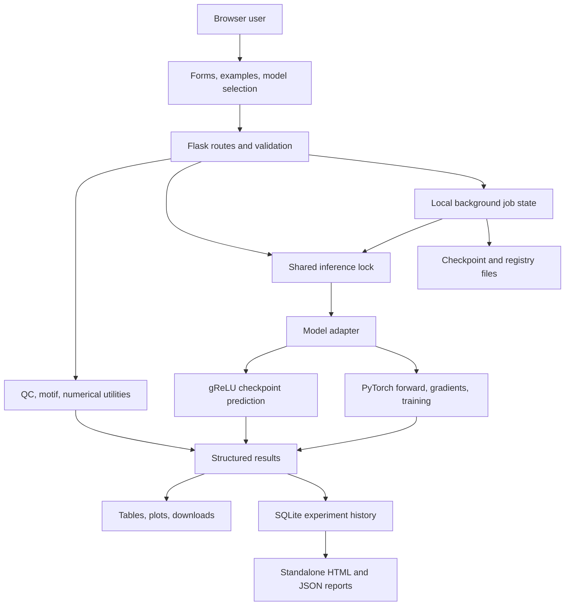
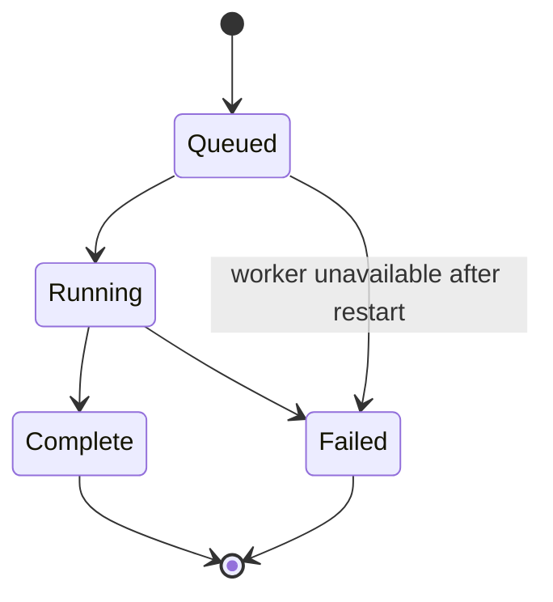

# gReLU Studio

**A browser-based prototype for regulatory sequence analysis and small-scale model development using gReLU and PyTorch.**

This college mini-project brings selected computational regulatory genomics workflows into one local website. Users can load examples, validate DNA, run supported models, compare variants, inspect sequence importance, explore motifs, train a small model, and save results without writing a separate Python script for every task.

The project is a **working prototype**, with deliberately bounded CPU workloads. It demonstrates integrated workflows; it is not a complete replacement for the gReLU Python package, a genome-wide production platform, or a biologically validated diagnostic system. Larger models, richer scientific methods, scalable execution, and production infrastructure are future scope.

> **Suggested presentation description:** “gReLU Studio is a prototype web workbench that reduces repeated scripting and workflow-management effort for selected regulatory genomics tasks. It combines model-aware examples, input validation, prediction, interpretation, small-scale model development, and reproducible result exports in one interface.”

This README is a usage guide and a reference for teammates preparing the project report, PPT, demonstration, and viva. Implementation descriptions refer to this repository. External references explain the underlying tools and scientific background.

## Contents

1. [Project abstract](#1-project-abstract)
2. [Problem statement and motivation](#2-problem-statement-and-motivation)
3. [Objectives, users, and scope](#3-objectives-users-and-scope)
4. [Scientific background](#4-scientific-background)
5. [Implemented feature catalogue](#5-implemented-feature-catalogue)
6. [Models and relationship to gReLU](#6-models-and-relationship-to-grelu)
7. [Architecture and execution flow](#7-architecture-and-execution-flow)
8. [Algorithms and interpretation](#8-algorithms-and-interpretation)
9. [Training and fine-tuning](#9-training-and-fine-tuning)
10. [Inputs, coordinates, and examples](#10-inputs-coordinates-and-examples)
11. [Installation and configuration](#11-installation-and-configuration)
12. [Usage and demonstration](#12-usage-and-demonstration)
13. [Experiments, accounts, and storage](#13-experiments-accounts-and-storage)
14. [Repository guide](#14-repository-guide)
15. [Testing and evidence](#15-testing-and-evidence)
16. [Hardware and performance](#16-hardware-and-performance)
17. [Limitations](#17-limitations)
18. [Future scope](#18-future-scope)
19. [Troubleshooting](#19-troubleshooting)
20. [PPT and project-report material](#20-ppt-and-project-report-material)
21. [Viva questions](#21-viva-questions)
22. [Glossary](#22-glossary)
23. [References](#23-references)

## 1. Project abstract

Regulatory genomics studies how DNA sequences influence biological processes such as gene regulation and chromatin accessibility. Deep learning libraries support prediction and experimentation in this field, but using them typically involves Python programming, model configuration, input preparation, repeated analysis scripts, and manual management of results. These steps create a practical barrier for students and users who want to explore a supported workflow through a graphical interface.

gReLU Studio addresses this problem through a self-hosted web prototype built with Flask, server-rendered HTML, JavaScript, gReLU, and PyTorch. The application provides sequence quality checks, sequence prediction, reference–alternate comparisons, bounded mutagenesis, gradient-based attribution, motif analysis, sequence design, and selected model-management functions. It also supports real small-data regression training and fine-tuning, with progress tracking, checkpoint retention, and reuse of registered models. Synthetic example files help users understand input requirements and demonstrate the application on limited hardware. Completed analyses can be stored as experiment snapshots and exported for later inspection.

The contribution is workflow integration and usability rather than a new neural network architecture. The current prototype demonstrates end-to-end software execution on small workloads, including a supported pretrained checkpoint. It does not establish biological accuracy on a new research dataset. Future development can extend it with GPU-backed execution, stronger evaluation, advanced interpretation, genome-aware inputs, and production infrastructure.

## 2. Problem statement and motivation

### 2.1 Problem being addressed

A user comparing two regulatory DNA sequences may need to:

1. Find and load a compatible checkpoint.
2. Determine its exact input window and output task.
3. Parse FASTA and construct encoded DNA tensors.
4. Write inference code and interpret output shapes.
5. Choose a consistent output-aggregation convention.
6. Repeat inference for variants, mutations, or controls.
7. Build plots and tables.
8. Record inputs, parameters, model identity, and results.
9. Repeat much of this setup for another analysis.

These are valuable programming skills, but they also create repeated setup work. Input mistakes, inconsistent scoring, and untracked outputs make demonstrations and small projects harder to reproduce.

**Problem statement:** Build a local web interface that makes a useful subset of regulatory sequence analysis accessible through validated forms, model-aware examples, consistent computation, and saved results on modest hardware.

### 2.2 What the website changes

| Activity | Script-oriented workflow | Prototype workflow |
|---|---|---|
| Prepare a first input | Read APIs and construct data manually | Load a matching example, then edit/upload |
| Check sequence length | Add checks to a script | View requirements and use Sequence QC |
| Compare a variant | Write reference/alternate inference code | Submit aligned inputs to a dedicated form |
| Inspect position effects | Generate mutations or gradients in Python | Select a bounded scan or attribution region |
| Train a small model | Write loading, training, and checkpoint code | Upload a strict CSV and configure a bounded job |
| Retain results | Save files and settings manually | Archive successful runs and export records |
| Explain output | Build custom visualizations | Inspect available plots, tables, and reports |

The website primarily reduces **interaction, scripting, and bookkeeping effort**. It does not eliminate neural-network compute costs, the need for suitable data, or scientific judgement. A percentage reduction in workload has not been measured.

### 2.3 Why a prototype is appropriate

A mini-project has limited development time, compute, data, and validation resources. A useful prototype demonstrates representative workflows with real execution while reserving expensive or specialized capabilities for future work.

This project favors short inputs, small datasets, restricted mutation windows, local execution, reusable fixtures, and inspectable outputs. Its structure can support extensions, but those extensions still require implementation and testing.

## 3. Objectives, users, and scope

### 3.1 Objectives

- Provide one browser workspace for selected analysis workflows.
- Validate inputs before expensive computation where possible.
- Show model identity and required input length.
- Supply editable example inputs across scientific tools.
- Run supported model computations and small-scale optimizer updates.
- Explain scoring conventions and output limitations.
- Preserve inputs, parameters, results, and available provenance.
- Support an understandable CPU-based college demonstration.

### 3.2 Intended users

| User | Likely use |
|---|---|
| Student | Learn inputs, prediction, variants, motifs, and interpretation |
| Teammate | Reproduce the demo and locate implementation details |
| Faculty evaluator | Review the problem, architecture, working scope, and limitations |
| Developer | Extend a workflow or add a supported integration |
| Research learner | Run small exploratory analyses with an appropriate model |

Users still need to understand a model's training context. The application cannot determine whether a submitted sequence is scientifically suitable merely because it passes format checks.

### 3.3 Scope categories

| Category | Meaning | Examples |
|---|---|---|
| Implemented prototype capability | Code performs the operation within limits | Prediction, QC, training, history |
| Bounded implementation | Working method with restricted breadth/workload | Local mutagenesis, greedy design, small-data fine-tuning |
| Exploratory scientific output | Real computation requiring further interpretation | K-mer enrichment, attribution, predicted changes |
| Environment-dependent integration | Requires checkpoints, network, packages, or memory | Pretrained inference, Model Zoo installation |
| Future scope | Proposed capability, not currently implemented | Durable distributed jobs, genome-wide VCF processing, TF-MoDISco |

### 3.4 How much of gReLU is covered?

There is **no audited package-coverage percentage**. Page counts do not measure coverage of gReLU APIs, architectures, data loaders, interpretation methods, and configurations.

The defensible statement is: **the prototype covers selected common workflow categories around gReLU and PyTorch, with bounded implementations and custom web utilities.** It does not expose the whole package. An actual coverage audit would require a fixed upstream version, capability inventory, definition of partial support, and evidence for each claim.

## 4. Scientific background

### 4.1 DNA and regulatory activity

DNA is represented using A, C, G, and T. N indicates an unknown base where allowed. Regulatory sequences influence when and where genes are active. Sequence models learn statistical relationships between DNA and measured targets from training data.

A score is specific to the model and task. It should not automatically be called gene expression, disease probability, or clinical risk. The supported GM12878 checkpoint predicts a DNase-related target, as described in its [official model card](https://huggingface.co/Genentech/GM12878_dnase-model).

### 4.2 Why input length matters

Models use particular input windows. The default demonstration model uses **200 bases**; the supported GM12878 model uses **2,114 bases**. Three 200-base FASTA records remain three short records. Their lengths are not added to satisfy a 2,114-base requirement.

Most prediction pages require every record to match the selected window. QC can inspect mismatched lengths. Model Comparison has an explicit resizing policy; other pages should not be assumed to silently resize inputs.

### 4.3 Tasks and output bins

A model may predict multiple tasks, called tracks in the interface. Some models return values across spatial output bins. The adapter normalizes supported outputs to the conceptual shape:

```text
(number of sequences, number of tasks, number of output bins)
```

A task's summary is generally its mean across output bins. Plotted profiles may be reduced to at most 100 displayed bins for readability; summary scores use the full output. A profile and its mean answer different questions.

### 4.4 Reference, alternate, and haplotype

- **Reference:** supplied baseline sequence.
- **Alternate:** aligned sequence containing supplied changes.
- **SNV:** substitution of one known base with another.
- **Haplotype:** a supplied combination of variants on one background.
- **Allele-specific analysis here:** comparison of supplied sequences, without read-based phasing.

A synthetic reference is a computational baseline, not automatically a verified reference-genome interval.

### 4.5 Reverse complement

Reverse complementation reverses DNA and exchanges A↔T and C↔G. Some workflows compare predictions in both orientations as a consistency diagnostic. Agreement does not establish biological accuracy.

## 5. Implemented feature catalogue

The example service supports **22 scientific/configuration workflow names**. This is an interface inventory, not package coverage. Accounts, history, and jobs add application functionality.

### 5.1 Prediction and variants

| Feature / route | Computation and outputs | Boundary |
|---|---|---|
| Regulatory Effects — `/` or `/variants` | Reference/alternate predictions, profiles, track scores, differences, JSON | Exactly one aligned known-base substitution; demo allows shorter input up to its window, other models require configured length |
| Allele-Specific Regulation — `/allele-specific` | Compares two supplied haplotypes across tracks | Exactly two aligned records; multiple substitutions allowed; no phasing inference |
| Variant Prioritization — `/prioritize` | Ranks supplied SNVs by absolute effect within each track | Reference first, at most 12 total records; not genome-wide discovery |
| Multi-Allelic Comparison — `/multi-allelic` | Compares reference with supplied alternatives/combinations | At most 12 total aligned records; no exhaustive combination generation |
| Sequence Prediction — `/predict` | Mean scores, GC content, reverse-complement scores, optional shuffled baseline | Up to 12 records of exact model length; baseline uses five shuffles |
| Sequence QC — `/qc` | Length, unknowns, GC, and model-length match | Up to 12 records; no inference or biological certification |
| Model Inspector — `/models` | Backend, device, input length, tasks, available training metadata | Checkpoint-dependent metadata; task-name display is bounded |

### 5.2 Interpretation, design, and perturbation

| Feature / route | Method and outputs | Boundary |
|---|---|---|
| Curated Saturation — `/saturation` | Three alternatives at eight fixed positions in bundled hg38 context; heatmap | 24 substitutions; requires pinned GM12878 checkpoint/hash |
| Sequence Design — `/design` | Greedy improving single-base edits, objective history, JSON/CSV/FASTA | Up to 12 iterations and 32 candidates/iteration, plus model-specific budgets; can accept zero edits |
| Batch Variants — `/batch-variants` | CSV validation, track effects, ranks, reverse-complement agreement, optional shuffled-context statistics | At most 24 variants; evaluation budget depends on shuffle count/model |
| Local Mutagenesis — `/mutagenesis` | Scores three alternatives per known-base position; heatmap, JSON/CSV | At most 24 positions; N positions skipped and reported |
| Attribution — `/attribution` | Corrected gradient × input, signed contributions, top positions, optional randomized-weight diagnostic | Input at most 20,000 bases; displayed region at most 200; exports retain full resolution |
| Motif Simulation — `/motif-simulation` | Equal-length motif replacement, optional partner/gaps, predicted changes, scrambled-primary controls | At most 12 configurations; length preserved; identical scrambled controls flagged |
| Model Comparison — `/model-comparison` | Two installed model/track selections; scores, raw differences, eligible Pearson correlation | Up to six records, windows at most 20,000; explicit transformation policy; scales may differ |

### 5.3 Model development and management

| Feature / route | Working behavior | Boundary |
|---|---|---|
| Training — `/training` | Real Adam regression training, epoch metrics, best checkpoint, model registration | 8–256 distinct sequences, length 50–2,000, 1–20 epochs |
| Fine-Tuning — `/fine-tuning` | Optimizes installed weights for one selected output and registers saved checkpoint | CPU, windows at most 4,096, at most 25 million parameters; full-weight updates |
| Model Zoo — `/model-zoo` | Revision-pinned download or cache-only registration, inspection, registration removal | Fixed eight-entry catalogue; large-model compatibility/installations not comprehensively verified |
| Job Progress — `/jobs/<job_id>` | Actual queued/running/complete/failed states, history, artifacts, archive links | Local daemon threads; active jobs do not survive restart |

### 5.4 Motifs and numerical utilities

| Feature / route | Working behavior | Boundary |
|---|---|---|
| Motifs — `/motifs` | Exact matches on both strands; exploratory canonical k-mer enrichment | Up to 32 patterns of 3–50 bases, 12 records, 50,000 total bases; not advanced motif discovery |
| PWM Scanning — `/pwm-scan` | Supported JASPAR/MEME matrices, both-strand log-odds scanning, coordinates, JSON/CSV | 32 matrices, widths 3–50, 50,000 bases, 10,000 hits; relative threshold is not a p-value |
| Dataset Overview — `/research/dataset` | FASTA/DNA or labeled CSV summaries, length/GC/label distributions, duplicate/unknown-base checks, saved reports | Up to 5,000 records and 200,000 bases; descriptive statistics without model loading |
| Benchmark — `/research/benchmark` | Regression/binary metrics for supplied observed/predicted values | 3–5,000 rows; does not generate predictions or prove held-out evaluation |
| Track Analysis — `/research/tracks` | Summary statistics and Pearson matrix | 2–16 unique numeric columns, 3–5,000 matched rows; no BigWig viewer |

**Scope update:** BED Validation has been removed from the current website, navigation, and example service. Its future replacement should validate genomic intervals, extract model-sized DNA windows from a selected reference assembly, and pass those sequences into prediction. It is listed in the roadmap rather than as a standalone current tool.

### 5.5 Workspace features

| Function | Behavior |
|---|---|
| Examples | Load editable inputs/settings directly into the form without starting computation |
| Experiment history — `/experiments` | Save successful runs, search/filter, reopen, rerun with edits, delete snapshots |
| Exports | JSON throughout; CSV, FASTA, checkpoints, and plots where appropriate |
| Standalone reports | Embedded HTML report and complete numerical record; browser printing for PDF |
| Accounts — `/account` | Local registration, activation, login, recovery/reset, logout, and editable profile settings |
| Shared interface | Navigation, model requirements, feedback, forms, and results; complete mobile acceptance remains pending |

## 6. Models and relationship to gReLU

### 6.1 Upstream foundation versus project contribution

[gReLU](https://genentech.github.io/gReLU/) supplies a regulatory genomics ecosystem with APIs and tutorials for inference, training, design, variant effects, and simulations. PyTorch supplies tensor execution, neural networks, automatic differentiation, and optimization.

This project adds the web application, validation, bounded orchestration, examples, visualization, local job handling, model registrations, experiment persistence, accounts, and reports. Some methods are project-specific calculations around model predictions rather than direct wrappers of an upstream high-level API.

The local trainer is a compact PyTorch loop. Exact pattern matching, simple k-mer enrichment, and CSV utilities are application features. Their presence must not be described as complete support for corresponding upstream research methods.

### 6.2 Built-in demonstration model

```text
Four-channel one-hot DNA
 → Conv1d(4 → 32, kernel 9) → ReLU
 → Conv1d(32 → 32, kernel 9) → ReLU
 → Conv1d(32 → output tasks, kernel 1)
```

The default configuration uses 200 bases, three tasks, and deterministic random initialization. **Its initial weights are untrained.** Its predictions demonstrate software execution rather than meaningful biological activity.

Training uses a one-target version of this compact architecture and performs actual optimization. Learning the synthetic GC target demonstrates the pipeline, not biological model quality.

### 6.3 Supported pretrained checkpoint

`Genentech/GM12878_dnase-model` takes 2,114-base hg38 sequences and predicts total DNase-seq coverage over the central 1,000 bases. The publisher lists about 6.3 million parameters. See the [official model description](https://huggingface.co/Genentech/GM12878_dnase-model).

The launcher checks this pinned cache entry:

```text
Repository: Genentech/GM12878_dnase-model
Filename:   model.ckpt
Revision:   9f2aaba3e04c5b7324a239c7af53fc4732cb2c3e
```

The curated scan also requires checkpoint SHA-256:

```text
f266b296f49b4e97e3ac52e94594da0aaae1d467778ea58b421e1ee7c4482bea
```

Published benchmark results belong to the original model/dataset. They are not accuracy results measured by this mini-project. Executing synthetic fixtures verifies integration, not the publisher's benchmark.

### 6.4 Model Zoo management

The fixed catalogue includes `human-atac-catlas`, `human-chromhmm-fullstack`, `enformer`, `decima`, `borzoi`, `GM12878_dnase`, `human-mpra-gosai-2024`, and `test` model repositories under Genentech. It is not a continuously synchronized complete upstream catalogue.

Online installation resolves a commit, downloads the pinned file, inspects it, and registers it locally. The remote-size check rejects files reported above 2 GB. Installation rejects input windows above 200,000 bases; analysis tools impose additional smaller limits.

**Use cached checkpoint** requires an exact 40-character hexadecimal revision and uses `local_files_only=True`. Missing weights are not fetched. Most entries use `model.ckpt`; Enformer uses `human.ckpt`, Borzoi `human_rep0.ckpt`.

A catalogue card does not guarantee execution on the local CPU. Broad installations and architecture compatibility remain unverified. Removing a registration retains shared cache/checkpoint files. The prototype does not accept arbitrary checkpoint uploads.

### 6.5 Identity and portability

Inference uses the selected installed model; catalogue references are not silently substituted with another model. Available provenance includes labels, hashes, library versions, and origin/revision information.

Fine-tuned files store state dictionaries and base-model specifications. Reconstruction can depend on the original architecture/checkpoint path. A downloaded checkpoint is not necessarily a portable standalone bundle.

## 7. Architecture and execution flow

### 7.1 Technology stack

| Layer | Technology | Purpose |
|---|---|---|
| Interface | HTML, Jinja, CSS, vanilla JavaScript | Forms, navigation, feedback, plots, downloads |
| Web application | Flask blueprints | Routes, validation, rendering, sessions |
| Model execution | gReLU and PyTorch | Checkpoints, prediction, gradients, optimization |
| Numerical processing | NumPy and task-specific Python | Transformations, statistics, ranking |
| Model distribution | Hugging Face Hub | Revisions, downloads, local cache |
| Persistent records | SQLite | Experiments and local accounts |
| Artifacts | Local filesystem | Jobs, checkpoints, registry, session key |
| Background work | Python threads and shared lock | Progress handling and serialized model work |
| Verification | unittest, Flask, optional Chromium | Numerical, integration, and UI checks |

### 7.2 Architecture diagram



### 7.3 Prediction flow

1. Select a model and load/upload input.
2. Browser helpers show requirements and perform early checks.
3. Flask parses and authoritatively validates submitted content.
4. The route constructs parameters and acquires the model-workload lock.
5. The adapter loads the model and encodes supported DNA.
6. Predictions are normalized to task/bin output.
7. The workflow calculates summaries, comparisons, and diagnostics.
8. Results are rendered and successful analyses archived.
9. Users download records or reopen a report.

Browser checks improve usability; server validation remains authoritative. Input should not be silently transformed into a different scientific question.

### 7.4 Adapter behavior

`core/models.py` handles supported built-in and gReLU model differences. It can use the gReLU prediction interface and fall back to a supported PyTorch forward pass if that path fails, recording a fallback note.

It also provides task metadata, reverse-complement evaluation, gradients, and randomized model copies for diagnostics. Handling an output shape does not establish compatibility with every architecture.

### 7.5 Jobs



Training, fine-tuning, and installation use local worker threads with status polling. Model work shares a lock and is serialized. Persisted job files do not preserve an executing thread across restart. Interrupted work cannot automatically resume; unavailable workers can be marked failed.

One application worker is the supported arrangement. Distributed scheduling, durable workers, cancellation, and resumability are future work.

### 7.6 Lower-level CLI

`engine.py` routes `info`, `zoo`, `predict`, `vep`, `design`, `scan`, and `attribution`. It sets seeds and returns JSON with success/error status, runtime, and workflow-specific outputs/evidence.

```bash
.venv/bin/python engine.py --workflow predict --params path/to/params.json
```

Parameter schemas differ by handler under `workflows/`. Not every website page is exposed through this router. The primary web entry point is `run_studio.sh`.

## 8. Algorithms and interpretation

### 8.1 Encoding and aggregation

Known DNA uses four-channel one-hot vectors, for example A = `[1,0,0,0]` in A/C/G/T order. Allowed N bases activate no known-base channel.

```text
score(sequence, task) = mean(prediction[task, all output bins])
```

A mean gives a consistent summary but may conceal local profile changes. Future task-specific workflows may require another aggregation policy.

### 8.2 Variant effect

```text
effect = score(alternate) - score(reference)
```

Positive means a higher model-task score; negative means lower. Neither implies beneficial, harmful, pathogenic, or causal. Prioritization ranks supplied absolute effects within tasks. Batch ordering can use each variant's largest absolute track effect; raw scales across tasks may not be comparable.

### 8.3 GC and QC

```text
GC fraction = (G count + C count) / known A/C/G/T count
```

Unknown bases are reported separately. Length/composition checks do not certify assembly, experimental context, or biological relevance.

### 8.4 In silico mutagenesis

For each scanned known position, construct three single-base alternatives, rerun prediction, and subtract the original score. Scanning `m` known positions produces `3m` candidate substitutions, in addition to baseline/diagnostic evaluations.

The curated scan uses zero-based input indices 1,053–1,060, equivalent to one-based positions 1,054–1,061, then maps them to its bundled locus. Uploaded-sequence scans use the user's local region. A whole-window scan can be much more expensive than a bounded local one.

### 8.5 Corrected gradient × input

For selected score `f(x)`:

```text
gradient[b,i] = derivative of f with respect to input x[b,i]
corrected[b,i] = gradient[b,i] - mean_over_bases(gradient[:,i])
contribution[b,i] = x[b,i] * corrected[b,i]
position_contribution[i] = sum_over_bases(contribution[:,i])
```

This is signed local sensitivity. It is not Integrated Gradients, DeepLIFT, SHAP, a measured mutation effect, or causal attribution. The randomized-weight Pearson diagnostic is descriptive rather than an automatic scientific pass/fail rule.

### 8.6 Shuffling and empirical controls

The dinucleotide shuffle represents adjacent base pairs as edges and constructs a randomized Eulerian traversal, preserving dinucleotide composition for supported inputs. It does not claim uniform sampling of every possible valid shuffle.

Prediction/design use small descriptive baselines. Batch variants can calculate:

```text
p_empirical = (1 + count(abs(background_effect) >= abs(observed_effect)))
              / (number_of_shuffles + 1)
```

Five shuffles allow a minimum of `1/6 ≈ 0.167`; they cannot establish conventional statistical significance. The prototype does not perform multiple-testing correction or establish an appropriate null model for every biological question.

### 8.7 Greedy design

```text
objective = selected on-target mean score
            - selected off-target mean score, if configured
```

The search proposes single-base edits, accepts improvement, and stops at a configured limit or patience of three non-improving iterations. Editable coordinates restrict changes. Candidate budgets are 384 for demo and 48 for other models.

It may find a local optimum or no accepted edits. Optimization and evaluation use the same model, so increased score requires independent validation before being called biological improvement.

### 8.8 Exact motifs and k-mer discovery

Exact scanning finds supplied patterns and reverse complements, deduplicating palindromic orientations. Discovery groups k-mers with their reverse complements, uses `k` from 3–10, retains counts of at least two, and ranks up to 30 candidates:

```text
enrichment = (observed_count + 1) / (shuffled_background_count + 1)
```

There is one dinucleotide-shuffled background per input sequence. This exploratory count method does not identify a transcription factor, fit a motif mixture model, or implement TF-MoDISco.

### 8.9 PWM scanning

Matrices are normalized by position, then mixed with positive base background `q` using smoothing `alpha`:

```text
p_smoothed(base,position) = (p_normalized(base,position) + alpha*q(base)) / (1+alpha)
weight(base,position) = log2(p_smoothed(base,position) / q(base))
window_score = sum(weight(sequence_base, motif_position))
```

Background frequencies sum to one; smoothing ranges from 0.0001–1. Both strands are evaluated; windows containing N are skipped.

Relative scores use each strand matrix's theoretical minimum and maximum. A threshold of 0.8 is not 80% binding probability, confidence, or a statistical p-value. The parser implements supported labeled JASPAR and minimal DNA MEME matrices, not every format extension. References: [JASPAR](https://jaspar.elixir.no/docs/) and [MEME format](https://meme-suite.org/meme/doc/meme-format.html).

### 8.10 Motif simulation and comparison

Simulation makes equal-length replacements, preserves untouched bases, and compares selected-task predictions against the original and optional scrambled-primary controls. This is a model-space perturbation experiment, not a length-changing insertion or binding assay. Scrambled controls preserve base counts but can retain relevant patterns.

Model Comparison can require exact lengths or explicitly center-crop/N-pad each model's input, recording transformed sequences and offsets. Raw `B − A` differences are descriptive when task scales differ. Pearson requires at least three nonconstant observations; using the same model twice provides a reproducibility check with a warning rather than independent agreement evidence.

### 8.11 Dataset Overview

Dataset Overview accepts FASTA/plain DNA or CSV with exactly `sequence,label` columns. It summarizes counts, total bases, minimum/maximum/mean/median lengths, A/C/G/T/N composition, repeated sequences, and repeated FASTA identifiers. It accepts varying lengths and duplicates so they can be inspected before training, rather than immediately rejecting them as the trainer does.

Per-sequence GC excludes N. Mean record GC gives equal weight to every sequence with known bases; pooled GC gives equal weight to every known base. All-N sequences have unavailable GC, not zero GC. The interface shows counted distributions and notes about variable lengths, duplicates, and unknowns.

Labeled CSV additionally reports numeric label statistics and a distribution. If every label is 0 or 1, it shows both class counts. Identical sequences with differing labels and constant targets are flagged for review. These checks do not establish biological validity or predictive quality.

Limits are 5,000 records, 200,000 total bases, and 550 KB of input text, also subject to the web request limit. Labels must be finite with magnitude at most 1,000,000. The page displays at most 200 record details; JSON preserves all summaries. Successful runs are saved, exportable, and repeatable. No model is loaded and no training job starts.

### 8.12 Evaluation metrics

| Metric | Meaning | Important boundary |
|---|---|---|
| MAE | Mean absolute error | Depends on target units |
| RMSE | Square root of mean squared error | Emphasizes larger residuals |
| Pearson | Linear association | Undefined for constant arrays; not calibration |
| Spearman | Association of average-tie ranks | Measures ordering, not absolute agreement |
| AUROC | Binary ranking across thresholds | Requires both classes |
| Average precision | Precision/recall ranking summary | Depends on class prevalence |
| Brier score | Squared probability error | Binary labels and valid probabilities required |
| ECE | Calibration gap in ten probability bins | Sensitive to binning and sample size |

```text
MAE   = mean(abs(observed - predicted))
MSE   = mean((observed - predicted)^2)
RMSE  = sqrt(MSE)
Brier = mean((binary_label - probability)^2)
```

The benchmark computes metrics from supplied values. It does not prove that they are held-out predictions. Undefined metrics are unavailable rather than invented.

## 9. Training and fine-tuning

### 9.1 Data requirements

Both pages require exactly these ordered CSV columns:

```csv
sequence,label
ACGTACGT...,0.42
TGCATGCA...,0.67
```

Ellipses indicate omitted bases and must not appear in a real input. Use **Load example** for executable, model-sized data.

The parser requires 8–256 distinct sequences of the required length, with finite numeric labels of magnitude at most 1,000,000. Exact duplicates are rejected to prevent them crossing the held-out split. Related or overlapping sequences can still leak information across a random split.

### 9.2 Actual training pipeline

1. Parse and validate the CSV.
2. Construct a compact one-target CNN or load the installed fine-tuning model.
3. Set seed 0 and deterministically shuffle record indices.
4. Reserve approximately 20% for validation, with at least two validation records.
5. One-hot encode sequences and create numeric target tensors.
6. Calculate initial validation MSE.
7. Run Adam updates with MSE and gradient-norm clipping at 1.0.
8. Evaluate validation MSE after each epoch, using bounded batches.
9. Retain the best state, including the initial state if no epoch improves it.
10. Save weights, register the model, and provide metrics/artifact downloads.

```text
CSV → validation → deterministic split → encoded tensors
    → Adam updates → epoch validation → best state
    → checkpoint → registered model → prediction reuse
```

### 9.3 Configuration and limits

| Setting | Prototype behavior |
|---|---|
| Training length | 50–2,000 bases |
| Fine-tuning length | Installed model window, at most 4,096 bases |
| Dataset | 8–256 distinct records |
| Epochs | 1–20 |
| Learning rate | 0.00001–0.01 |
| Batch size | Default 8; environment setting supports 1–32 |
| Optimizer/loss | Adam / selected task mean-output MSE |
| Parameter ceiling | 25 million |
| Device | CPU in the website |
| Retained checkpoint | Lowest validation MSE, possibly epoch 0 |

### 9.4 Fine-tuning semantics

Fine-tuning starts from installed weights and updates parameters using labels for one selected output. The current implementation updates the full model. There is no layer-freezing selector, LoRA, or adapter-training interface. Shared-weight changes can affect other outputs of a multi-task model.

These are real optimizer updates, but a tiny supported dataset is suitable for software demonstrations rather than strong generalization claims. Task compatibility and target scaling remain important.

### 9.5 What the examples demonstrate

The training example contains 40 sequences with varying GC composition and their GC fractions as labels. Fine-tuning examples contain eight model-sized labeled records with a short starter configuration. They are synthetic learning targets.

A demonstration can show loss updates, optimizer steps, checkpoint creation, and prediction reuse. Declining loss does not prove useful biology. Compare against the reported mean-label baseline and evaluate independently before making performance claims.

For example, the recorded small GM12878 fine-tuning check reduced validation MSE from approximately 28.06 to 1.23, while its mean-label baseline was approximately 0.0237. That check verified optimization and checkpoint reuse; it did not outperform that simple baseline or establish biological utility.

### 9.6 What stronger validation needs

A research evaluation needs a suitable real dataset, train/validation/test separation, chromosome- or region-aware splitting where appropriate, leakage checks, meaningful baselines, justified target transformations, repeated runs, and uncertainty reporting. The demonstration's random 80/20 split is not a substitute.

## 10. Inputs, coordinates, and examples

### 10.1 General conventions

- Use the format required by the selected tool: DNA text, FASTA, CSV, or a supported motif matrix. BED input is reserved for future genome-aware workflows.
- Length means bases per record after parsing, not file size or total bases across records.
- Most model pages require exact windows; QC deliberately accepts mismatches.
- The request-size ceiling is **600,000 bytes**, including multipart overhead. This can be reached before a workflow's theoretical record limit.
- Known A/C/G/T bases are required for substitutions and design seeds. N handling is workflow-dependent.
- The website does not infer genome assembly or automatically fetch sequence context from genomic coordinates.

### 10.2 FASTA

```fasta
>record_one
ACGTACGTACGT
>record_two
ACGTTCGTACGT
```

These 12-base records illustrate syntax only; they are too short for normal 200- or 2,114-base prediction. Headers begin with `>` and subsequent sequence lines belong to that record until the next header.

Record order matters for reference-first workflows. A single-substitution page requires exactly one difference; haplotype/multi-allelic pages permit their documented aligned changes.

### 10.3 Batch variants

```csv
variant_id,sequence,pos,ref,alt
example_1,ACGTACGT,3,G,A
```

This is syntax-only short input. Actual sequences must have the selected model's length. The ordered header is strict. IDs must be distinct and 1–100 characters. `pos` is one-based within the supplied sequence; `ref` must match it and `alt` must be a different known base. All rows are validated before inference.

This is not VCF upload or coordinate-to-genome-context extraction.

### 10.4 Other formats

| Tool | Structure |
|---|---|
| Training/fine-tuning | Exactly `sequence,label` |
| Benchmark | `observed,predicted` numeric values |
| Binary benchmark | Labels 0/1; probabilities in [0,1] |
| Track analysis | Unique numeric column names and matched observations |
| Exact motifs | One `motif_name:ACGT...` per line |
| PWM scan | Supported labeled JASPAR counts or minimal MEME DNA probabilities |

### 10.5 Coordinates

| Context | Convention |
|---|---|
| Batch `pos` | One-based in supplied sequence |
| User-selected regions | One-based inclusive |
| Motif/PWM hits | One-based inclusive sequence coordinates |
| BED (future scope) | Zero-based start, end exclusive |
| Curated genomic output | Genomic one-based coordinates from bundled locus metadata |
| Internal Python indices | Generally zero-based |

For the proposed BED integration, `chr1 100 110` spans ten bases, equivalent to one-based inclusive 101–110. Coordinate errors can change interpretation even when syntax is valid.

### 10.6 Example controls

Select the model **before** loading a model-dependent example.

**Load example** fills editable inputs and starter settings. It does not submit a form, load weights, create predictions, or start a job. Existing file-upload selections are cleared so stale files cannot override loaded text. Select Run/Start separately after review.

Inspector, curated scanning, and Model Zoo load configuration presets rather than DNA uploads or checkpoint weights. A Model Zoo preset does not install a model. Example-file download buttons are not shown in the interface.

QC examples intentionally include problems. Showing short or unknown-base-containing sequences can be the expected result of a successful validation demonstration.

### 10.7 Bundled fixtures

| Location | Purpose |
|---|---|
| [Fixture guide](test-inputs/README.md) | Instructions and expected behavior |
| [200-base examples](test-inputs/quick-demo-200bp/) | FASTA for the demonstration model |
| [2,114-base examples](test-inputs/trained-model-2114bp/) | Corresponding pretrained-model FASTA |
| [Additional workflow inputs](test-inputs/new-workflows/) | Seeds, variants, training, matrices, comparison records |
| [Acceptance manifest](test-inputs/website-suite/manifest.json) | Planned whole-site scenarios |
| [Acceptance inputs](test-inputs/website-suite/) | Settings, negative fixtures, synthetic account fixtures |
| [Demonstration guide](DEMO_GUIDE.md) | Complementary walkthrough |

The model-sized FASTA folders contain reference/alternate files, paired haplotypes, prioritization candidates, multi-allelic records, three-record predictions, and QC samples. Shared active fixtures cover regression, binary metrics, and tracks. The older BED fixture is retained only as reference material for future development.

Sequences are synthetic unless explicitly identified as curated genomic context. A synthetic 2,114-base input is not automatically a valid hg38 locus.

## 11. Installation and configuration

### 11.1 Existing environment

From this checkout with its existing `.venv`:

```bash
bash run_studio.sh
```

Open `http://127.0.0.1:5000/`. For the shared development port:

```bash
PORT=5008 bash run_studio.sh
```

Open `http://127.0.0.1:5008/`.

The launcher checks only the local cache for the pinned pretrained model. It does not download it during startup. Without that cached checkpoint, the demo model remains available. Once dependencies and weights are present, local inference does not need a new model download.

### 11.2 Fresh installation and packaging caveats

`pyproject.toml` currently declares Python **3.14 or newer**; the working environment uses Python 3.14. Other Python/library combinations require compatibility checks.

The package metadata currently has an empty runtime dependency list. Installing the project alone does not recreate the ML environment. `requirements-lock.txt` is a large environment snapshot, with hardware-specific dependencies and a machine-specific editable-install entry. It is not a universal minimal portable lockfile.

For a comparable Linux/WSL environment, begin with:

```bash
python3.14 -m venv .venv
.venv/bin/python -m pip install --upgrade pip
```

Review the snapshot for the target hardware/OS. If using it, remove the original checkout-path entry in a temporary copy:

```bash
.venv/bin/python - <<'PY'
from pathlib import Path
lines = Path('requirements-lock.txt').read_text().splitlines()
lines = [line for line in lines if not line.startswith('-e file:')]
Path('/tmp/grelu-studio-requirements.txt').write_text('\n'.join(lines) + '\n')
PY
.venv/bin/python -m pip install -r /tmp/grelu-studio-requirements.txt
```

This removes a path-specific entry; it does not guarantee compatibility of every pinned dependency. GPU-related packages can make downloads large. For a clean CPU environment, choose PyTorch using its [official installation selector](https://pytorch.org/get-started/locally/) and verify gReLU and the remaining dependencies together. A smaller tested CPU/GPU dependency specification is future maintenance work.

Use `bash run_studio.sh` after dependencies are available. Fresh-machine portability has not been exhaustively verified.

### 11.3 Environment variables

| Variable | Purpose | Default / requirement |
|---|---|---|
| `PORT` | Launcher port | 5000 |
| `GRELU_HUMAN_CHECKPOINT` | Trusted local checkpoint path | Optional; launcher can discover pinned cache |
| `GRELU_HUMAN_INPUT_LENGTH` | Configured model's required length | Required with manually supplied checkpoint |
| `GRELU_HUMAN_MODEL_ID` | Display identity | Configurable label |
| `GRELU_TRAIN_BATCH_SIZE` | Training/validation batch size | 8; allowed 1–32 |
| `GRELU_DISPLAY_TIMEZONE` | Report/history timezone | Asia/Kolkata; storage is UTC |
| `GRELU_SECRET_KEY` | Stable session secret | Local ignored key file if absent |
| `GRELU_HTTPS` | Secure cookies for HTTPS | Set to 1 only with HTTPS |
| `GRELU_ACCOUNT_LOCAL_PREVIEW` | Show activation/reset links | 1; setting 0 does not enable email |

Manual trusted-model configuration:

```bash
GRELU_HUMAN_CHECKPOINT=/absolute/path/to/model.ckpt \
GRELU_HUMAN_INPUT_LENGTH=2114 \
GRELU_HUMAN_MODEL_ID='Genentech GM12878 DNase' \
PORT=5008 bash run_studio.sh
```

Restart when changing startup checkpoint configuration. An arbitrary checkpoint may be incompatible even when its declared input length matches.

### 11.4 Lab hosting

The launcher uses Flask's local development server. Lab hosting needs a WSGI server and suitable HTTPS/access control. With Gunicorn separately installed:

```bash
gunicorn --bind 127.0.0.1:8000 --workers 1 --timeout 180 studio_web:app
```

Use one worker with the current in-process jobs/lock. This is not a complete production configuration. Public accounts also need actual email delivery and further security/operational work.

## 12. Usage and demonstration

### 12.1 First analysis

1. Start the server and open its URL.
2. Open Sequence Prediction.
3. Select the 200-base demo model.
4. Load its example and inspect the records.
5. Run prediction.
6. Explain the selected task scores and model identity.
7. Download JSON or open the saved experiment.

State that the initial demo weights are random. To demonstrate an actually pretrained model, select installed GM12878 and load a fresh matching example before running.

### 12.2 Variant demonstration

1. Open Predicted Regulatory Effects and select a model.
2. Load the example and identify its one changed base.
3. Run comparison and show reference, alternate, and delta.
4. Explain the task and alternate-minus-reference convention.
5. Open Prioritization/Multi-Allelic Comparison to show related structures.
6. Use Local Mutagenesis to explain all three alternatives at selected positions.

Explain one heatmap cell before the entire heatmap. Do not equate its sign with clinical importance.

### 12.3 Training demonstration

1. Open Training with length 200.
2. Load the GC-regression example.
3. Start a short run, such as two epochs.
4. Show real job statuses and training/validation losses.
5. Inspect best epoch, optimizer steps, and mean-label baseline.
6. Download the checkpoint and reuse the registered model.

Loss need not decrease monotonically; the retained best epoch can be zero. Do not promise a particular curve.

### 12.4 Motif demonstration

Start with exact matching to explain patterns and strands. Then show a PWM input and a scored hit to explain position-dependent preferences. Describe k-mer discovery as exploratory and explain its small shuffled background.

### 12.5 Suggested live-demo sequence

| Segment | Activity | Main point |
|---|---|---|
| 1 | Workspace and example loading | Unified, model-aware preparation |
| 2 | QC and prediction | Validation then real computation |
| 3 | Variant comparison | Consistent effect calculation |
| 4 | Mutagenesis or attribution | Sequence interpretation methods |
| 5 | Short training / saved completed job | Real optimization and checkpoint reuse |
| 6 | Motifs or PWM scan | Model-independent analysis |
| 7 | History and report | Traceability and exported artifacts |
| 8 | Limitations and future scope | Honest prototype boundary |

For an eight- to twelve-minute demo, prepare expensive pretrained runs beforehand. Showing a previously completed real record is useful; identify it as saved rather than pretending it is running live.

## 13. Experiments, accounts, and storage

### 13.1 Saved experiments

Successful analyses retain inputs, settings, results, and available model provenance. Completed training/fine-tuning jobs can be archived too. History provides title/workflow search, filters, pagination, reopening, and rerunning with edits.

A rerun creates a new snapshot. Deletion removes the saved record, not trained weights, cache files, or downloaded copies.

Guests have browser-session ownership tokens; authenticated users have account-associated history. Sign-in claims that browser's guest history, including ownership handling for jobs completed after sign-in. This is application ownership separation, not database encryption or compliance certification.

### 13.2 Exports and reports

Standalone HTML reports embed assets, supported SVG plots, notes, and numerical records. Tables show at most the first 200 rows for readability; complete records remain in JSON. Reports escape supplied text and use a restrictive script policy.

Use browser **Print / Save as PDF** for PDF. There is no server-side PDF service. Downloaded records contain submitted DNA, so sharing them also shares those inputs.

### 13.3 Accounts

Local registration, activation, login, recovery/reset, and logout are implemented. Inactive-account recovery can issue replacement activation links. Tokens expire after one hour, are single-use, and are stored as hashes. Passwords are hashed with Werkzeug; reset invalidates existing sign-ins through session-version handling.

Signed-in users can open Account settings to change their display name, upload/remove a profile picture, update their email, and change their password. Pictures accept still PNG/JPEG/WebP files up to 400 KB and four megapixels, are normalized to 256 × 256 PNG without original metadata, and appear in the account page, sidebar, and header. Images are stored with the local account database and served only to their owner. Older account databases receive an additive migration without replacing existing users.

Email and password updates require the current password. They invalidate other sessions and existing recovery tokens while retaining the current signed-in session. The local prototype updates email immediately after password confirmation; it does not verify ownership of the new address through email delivery. Production email-change verification remains future work.

Account forms use CSRF. Signed sessions use HTTP-only/SameSite settings and optional HTTPS secure cookies. These controls do not constitute a full production identity system.

**No email provider is integrated.** Local preview displays activation/reset links. `GRELU_ACCOUNT_LOCAL_PREVIEW=0` hides them but sends no email. Analysis remains available to guests.

### 13.4 Local storage

| Path | Content |
|---|---|
| `instance/accounts.sqlite3` | Accounts, token/session-related records |
| `instance/experiments.sqlite3` | Snapshots and ownership |
| `instance/session.key` | Local signing secret if no environment secret |
| `instance/lab/jobs/` | Job states, checkpoints, artifacts |
| `instance/lab/models.json` | Managed registrations and provenance |
| Hugging Face cache | Upstream model files |
| `test-results/` | Local QA reports, screenshots, downloads, resource records |

Runtime data is ignored by version control. Fresh clones do not contain someone else's accounts, history, model cache, or generated evidence. Back up databases and associated files together if retaining experiments and trained models.

## 14. Repository guide

### 14.1 Main structure

```text
GRELU-Studio/
├── studio_web.py          # App, base comparison, startup model configuration
├── workbench.py           # Prediction, QC, related workspace routes
├── variant_views.py       # Shared variant presentation
├── advanced_views.py      # Design, batch, mutagenesis, attribution
├── exploration_views.py   # PWM, simulation, comparison
├── research_views.py      # Dataset overview, benchmark, numerical tracks
├── curated_scan.py        # Fixed genomic-locus scan
├── curated_loci.json      # Bundled genomic context
├── lab_views.py           # Training, fine-tuning, motifs, Zoo, jobs
├── lab_compute.py         # Regression trainer and motif calculations
├── lab_jobs.py            # Local threads and persisted job status
├── model_registry.py      # Managed model registration
├── example_views.py       # Example inputs/configurations and downloads
├── experiment_views.py    # History, rerun, exports
├── experiment_store.py    # SQLite snapshots and ownership
├── report_builder.py      # Standalone HTML reports
├── account_views.py       # Accounts and session setup
├── studio_services.py     # Shared services
├── engine.py              # Lower-level router and CLI
├── core/                  # Models, sequences, stats, PWM, I/O, devices
├── workflows/             # Reusable computational handlers
├── templates/             # Jinja pages and shared controls
├── static/                # CSS and JavaScript
├── tests/                 # Regression/integration/browser checks
├── scripts/               # Fixtures and optional QA setup
├── test-inputs/            # Synthetic examples and acceptance manifest
├── run_studio.sh           # Launcher and pinned cache discovery
├── requirements-lock.txt  # Existing environment snapshot
├── pyproject.toml         # Packaging metadata; dependencies incomplete
├── DEMO_GUIDE.md           # Complementary demo notes
└── README.md               # Project and presentation guide
```

### 14.2 Where to investigate

| Topic | Start here |
|---|---|
| Checkpoints and output shapes | `core/models.py` |
| Encoding, reverse complement, shuffling | `core/sequences.py` |
| Batch effects and variants | `workflows/vep.py`, `advanced_views.py`, workbench/variant routes |
| Attribution | `workflows/attribution.py` |
| Greedy optimization | `workflows/design.py` |
| Mutagenesis | `workflows/scan.py`, `curated_scan.py` |
| PWM parsing/scoring | `core/pwm.py` |
| Simulation/comparison | `workflows/explore.py`, `exploration_views.py` |
| Training and best-state retention | `lab_compute.py` |
| Installation/registry | `lab_views.py`, `model_registry.py` |
| Examples | `example_views.py`, `static/examples.js`, `templates/example_controls.html` |
| History and reports | `experiment_store.py`, `experiment_views.py`, `report_builder.py` |
| Account tokens and reset | `account_views.py` |
| Interface | `templates/base.html`, `static/studio.css`, relevant page scripts |

### 14.3 Extending the project

A workflow extension normally needs validation, computation, route/template, navigation, examples, result/export support, and meaningful checks. Define a realistic workload limit and execution strategy before exposing expensive controls.

Preserve actual model identity and input transformations. Do not silently substitute demo weights or claim an unsupported method. Good consistency checks compare related operations: for example, a scan delta should equal a direct pairwise comparison of the same sequences.

## 15. Testing and evidence

### 15.1 Evidence types

| Evidence | What it addresses | What it does not prove alone |
|---|---|---|
| Validation check | Malformed input is rejected usefully | Biological accuracy |
| Numerical consistency check | Related calculations agree / match a hand calculation | A true biological mechanism |
| Checkpoint round trip | Weights can be saved, reloaded, and used | Generalization to unseen biology |
| Browser acceptance | A tested user flow works with actual files | Every environment/viewport works |
| Resource record | Memory/time for one configuration | Requirements of every model/machine |
| Biological benchmark | Performance on a specified dataset/protocol | Universal or clinical validity |

### 15.2 Recorded verification status

The existing record is **partial acceptance coverage**, not complete all-features certification:

- **25 earlier automated regression checks passed**, covering account behavior, workflow consistency, training/checkpoint reuse, motifs, history, and reports.
- **Six Dataset Overview checks passed**, covering statistics, input limits, both example formats, file uploads, history/reports, and no model execution. These are lightweight integration/numerical checks, not browser acceptance.
- **Seven targeted example-loading checks passed** after the shared example controls were added. These did not execute inference, training, or a browser.
- **36 of 42 planned file-based website acceptance scenarios passed** using real Chromium, real HTTP, uploaded fixtures, and actual computation, with zero failures among completed scenarios. The run was interrupted before completion.
- **One additional pretrained fine-tuning scenario passed separately** through a low-memory HTTP integration run. This brings distinct verified scenarios to **37 of 42**, using mixed layers rather than 37 browser scenarios.
- Pending acceptance scenarios are accounts, cached Model Zoo registration, history/reports, mobile navigation, and negative-input flows. Some underlying behaviors have regression coverage, but these complete acceptance flows remain unverified.

The earlier 25 checks and seven example checks were not all rerun together after the latest UI edits. They must not be presented as a newly completed one-shot full-suite result.

The counts above describe the historical acceptance run before BED Validation was retired. The current active manifest contains 43 scenarios after removing that case and adding FASTA/CSV Dataset Overview cases; the revised full manifest has not been rerun. Older saved BED results remain readable, but cannot be rerun through the website.

### 15.3 Completed browser coverage

The 36 completed cases included demo/pretrained variants of comparison, haplotypes, prioritization, multi-allelic analysis, prediction, QC, inspection, design, batch variants, mutagenesis, attribution, and simulation. Other cases covered shuffled prediction, curated scanning, regression/binary metrics, tracks, BED, exact motifs, JASPAR/MEME PWM inputs, model comparison, training, and local-model fine-tuning.

Synthetic inputs verified application execution, not biological accuracy. The acceptance manifest defines the intended cases; completed result artifacts determine which actually ran.

### 15.4 Pretrained fine-tuning evidence

A separate GM12878 check used eight 2,114-base sequences, one epoch, batch size one, and six optimizer steps. The checkpoint was saved and reloaded for prediction. Its resource wrapper recorded approximately **1,563 MB peak process-tree RSS** and approximately **51 seconds** for the phase on the tested machine.

These are measurements from one constrained run, not a universal RAM requirement or speed promise. Labels were synthetic and the fine-tuned model did not outperform the simple mean-label baseline.

### 15.5 Verification limits

Broad online Model Zoo installation, other large checkpoints, GPU execution, production email, full mobile acceptance, and biological generalization have not been verified end to end. An older local browser report contains a broad cached-registration statement; that wording is not evidence that the pending cached Model Zoo acceptance case completed.

Whole-site testing stopped after reported VS Code/WSL instability during resource-heavy runs. Its exact cause was not established from system OOM logs. Updating documentation does not restart those tests.

### 15.6 Test files

| File | Purpose |
|---|---|
| `tests/test_studio_web.py` | Routes, accounts, existing workflows |
| `tests/test_dataset_overview.py` | Hand-calculated statistics, distribution counts, malformed data, resource limits, saved reports, and no model/job execution |
| `tests/test_account_settings.py` | Profile edits, image validation/privacy, credential checks, session revocation, and existing-database migration |
| `tests/test_advanced.py` | Design, batch/scan consistency, gradients, shuffles, validation |
| `tests/test_lab.py` | Training/fine-tuning round trip and motif behavior |
| `tests/test_exploration.py` | PWM calculations, simulation, comparison, history, safe reports |
| `tests/test_example_loading.py` | Controls, lengths, files, downloads, absence of execution side effects |
| `tests/smoke_trained.py` | Optional checks using a real cached checkpoint |
| `tests/run_website_suite.py` | Optional file-based browser acceptance |
| `tests/run_low_memory_checks.py` | Resource-guarded phases and process cleanup |
| `tests/finish_file_checks.py` | Selected integration/persistence cases |
| `scripts/generate_website_fixtures.py` | Rebuild acceptance fixtures |
| `scripts/setup_browser_qa.py` | Optional local QA tooling setup |

### 15.7 Commands for future verification

Light input-only checks:

```bash
OMP_NUM_THREADS=1 .venv/bin/python -m unittest discover -s tests -p test_example_loading.py -v
```

General regression checks can run models and training:

```bash
OMP_NUM_THREADS=1 MKL_NUM_THREADS=1 OPENBLAS_NUM_THREADS=1 \
.venv/bin/python -m unittest discover -s tests -v
```

Optional heavier cached-checkpoint check:

```bash
.venv/bin/python tests/smoke_trained.py --fine-tuning
```

Choose scope according to memory. Browser dependencies need separate setup and may be absent in a fresh checkout. Evidence, when retained locally, is under ignored `test-results/whole-website/` and `test-results/low-memory/`; these artifacts are not guaranteed to accompany a clone.

## 16. Hardware and performance

### 16.1 Current device behavior

Website model workloads currently run on CPU. Lower-level device-selection helpers do not mean that the web forms provide a working GPU path. Installing a GPU alone will not move jobs to CUDA; that requires application integration.

QC and small numerical/motif utilities avoid loading a prediction model. Inference, gradients, scans, design, and training have different resource requirements.

### 16.2 Cost drivers

| Workload | Main drivers |
|---|---|
| Prediction | Architecture, length, batch, record count |
| Variant comparison | Repeated reference/alternate predictions |
| Mutagenesis | Three alternatives per scanned known position |
| Design | Candidate count across iterations |
| Attribution | Gradients and backpropagation activations |
| Fine-tuning | Weights, gradients, optimizer state, activations |
| Installation | Download size, deserialization, inspection memory |

Checkpoint size alone cannot predict training memory. Framework overhead, optimizer state, activations, and other processes also matter. GPU planning should use measurements for the intended architecture, input, batch, and precision.

### 16.3 Practical usage on limited hardware

Use demo weights for UI walkthroughs, small regions for scans, and low candidate counts for design. Run one heavy workload at a time. Avoid concurrent browser automation and training on constrained WSL instances.

`GRELU_TRAIN_BATCH_SIZE=1` can reduce training/validation batch memory but cannot eliminate model/optimizer costs or guarantee success. Present the project as **CPU-compatible for selected bounded workflows**, not a way to make every large genomics model lightweight.

## 17. Limitations

### 17.1 Scientific

- Synthetic fixtures establish execution/input behavior, not biological accuracy.
- The initial demo network has random weights.
- Pretrained outputs inherit training-data, target, genome, and generalization limitations.
- Variant deltas are not clinical classifications or causal proof.
- Gradients and mutagenesis measure different aspects of model behavior.
- Greedy design can exploit model weaknesses and requires independent validation.
- Tiny shuffled backgrounds produce coarse exploratory controls.
- Simple k-mer discovery is not specialized motif discovery.
- Training lacks chromosome-aware splits and an independent biological test pipeline.
- Cross-model/task raw scores may have incompatible scales and meanings.

### 17.2 Software and operations

- CPU execution and workload limits restrict scale.
- Jobs are serialized local threads without cancellation, durable resume, or distributed scheduling.
- Model Zoo is a fixed catalogue; broad model compatibility remains unverified.
- Restart loses active computation even though completed files persist.
- Fine-tuned artifacts can depend on base-model files/paths.
- Email delivery, production hosting, and operational hardening remain future work.
- Dependency packaging needs a portable tested specification.
- Complete browser/mobile acceptance is unfinished.
- Genome-aware VCF processing and experimental validation are absent.

### 17.3 Data and checkpoint trust

Use trusted official or administrator-vetted checkpoints. Constrained loading paths and the absence of an arbitrary upload interface reduce exposure, but model deserialization remains a trust boundary.

Stored/exported experiments contain input DNA. Local ownership does not establish encryption, regulatory compliance, or suitability for sensitive data. Do not commit private sequences, passwords, account databases, or session keys.

### 17.4 Appropriate project claims

**Supported:** “The prototype integrates selected workflows and demonstrates real inference, bounded model development, and experiment export.”

**Needs measurement:** “The interface reduces preparation time by a specific percentage” or “the trained model improves biological accuracy.”

**Outside current evidence:** “90% of gReLU is implemented,” “every listed model works,” “variants are clinically classified,” or “the platform is production-ready.”

A precise prototype scope makes the project easier to defend: the integration contribution and remaining research work are explicit.

## 18. Future scope

These are proposed extensions, not current functionality. Stages express useful priorities/dependencies rather than promised delivery dates.

| Stage | Proposed extension | Value | Evidence required |
|---|---|---|---|
| 1. Reproducible foundation | Portable CPU environment, clean setup guide, remaining acceptance cases | Easier teammate reproduction | Fresh-machine setup and complete scenario record |
| 2. Scientific evaluation | Real datasets, independent tests, chromosome-aware splits, baselines | Separate software success from predictive quality | Reproducible held-out benchmark |
| 3. Durable execution | Separate queue/workers, cancellation, timeouts, supported resume | Prevent web restarts losing active work | Restart/failure/recovery and ownership tests |
| 4. GPU integration | Explicit devices, CUDA workers, batching, precision/memory controls | Larger supported workloads | Measured memory/runtime on verified configurations |
| 5. Genome-aware inputs | BED validation, assembly selection, reference-genome sequence extraction, BED/VCF-to-prediction workflows, indel policies | Less manual sequence preparation | Coordinate/allele/contig/boundary checks |
| 6. Advanced development | Classification, multi-task targets, transfer heads, freezing, schedules, augmentation, suitable LoRA | More realistic adaptation | Baselines and checkpoint compatibility |
| 7. Interpretation | Integrated Gradients, justified references, perturbation comparisons, uncertainty | Complementary explanations | Numerical checks and sanity diagnostics |
| 8. Motif analysis | Stronger enrichment, database annotation, specialized discovery such as TF-MoDISco | Beyond exact hits and simple counts | Controlled benchmarks and known-motif recovery |
| 9. Model management | Catalogue synchronization, compatibility matrix, portable bundles, rollback | Clearer supported-model behavior | Per-model install/inference/round-trip evidence |
| 10. Collaboration | Email, roles, shared projects, auditing, deployment automation, backups | Managed multi-user use | Security/operations review and deployment checks |
| 11. Visual exploration | Rich profiles, genome-browser tracks, dashboards, customized reports | Better investigation and communication | Usability and coordinate-consistency checks |

### 18.1 Most valuable next increment

Complete acceptance testing, improve environment reproducibility, and evaluate one small real biological dataset properly. These strengthen the existing project more than many unverified menu additions.

### 18.2 Measuring workload reduction

For a defensible quantitative claim, compare identical tasks using scripts and the website on the same machine/model/inputs. Measure:

- Time to prepare valid inputs and launch analysis.
- Required code edits or interactions.
- Input errors and retries.
- Time to obtain a correctly documented result.
- Model runtime separately from interaction time.
- Participant experience and repeated-trial variation.

Report task definitions, sample size, and variation. Reduced clicking is not faster neural-network execution. Until this study exists, use the qualitative claim of reduced repeated scripting and bookkeeping.

## 19. Troubleshooting

| Symptom | Explanation | Action |
|---|---|---|
| “Each record must be 2,114 bases” | A 200-base file was used with GM12878 | Select intended model, then reload its example / matching folder |
| QC flags short/N-containing records | Example intentionally includes issues | Explain flags or use suitable exact-length input |
| Load example does not run | Input loading and execution are separate | Review and select Run/Start |
| Catalogue model unavailable in predictor | It is not installed/compatible | Register supported weights and check requirements |
| Cache registration misses file | Exact repository/file/revision absent | Verify revision or explicitly install online if appropriate |
| Curated scan disabled | Expected checkpoint/hash absent | Use the pinned checkpoint; arbitrary models are insufficient |
| Training rejects CSV | Headers, duplicates, length, labels, or count invalid | Use loaded example as format guide and fix reported issue |
| Best epoch is zero | No trained epoch improved initial validation | Inspect data, scaling, learning rate, and baseline |
| Job queued/failed after restart | Lock busy or thread no longer exists | Inspect status; interrupted work needs a fresh job |
| Registered model fails after moving files | Artifact/base paths unavailable | Restore associated resources; bundle portability is future work |
| Request too large | Form exceeds 600,000 bytes | Reduce input/record count, including repeated text |
| Activation link shown locally | Preview mode; no email provider | Use locally; implement delivery for public accounts |
| Session changes unexpectedly | Secret changed, reset invalidated session, cookie mismatch | Stable secret; HTTPS cookies only with HTTPS |
| WSL/VS Code unstable during tests | Resource pressure is possible; cause needs logs | Stop heavy runs, avoid concurrent tests, inspect memory |
| Old example controls visible | Stale server/browser version | Restart local server and refresh |
| Installing project omits ML packages | Runtime metadata dependencies incomplete | Review environment reconstruction caveats |

## 20. PPT and project-report material

### 20.1 Title and positioning

**Suggested title:** “gReLU Studio: A Web-Based Prototype for Regulatory Sequence Analysis and Model Development.”

**Objective:** “Reduce repeated scripting and result-management effort for selected genomics workflows through a validated, self-hosted interface.”

**Contribution:** “Integrate model-aware inputs, real bounded computation, interpretation tools, small-data model development, and experiment reporting into one accessible workflow.”

These statements describe integration without claiming a new prediction architecture, universal support, or unmeasured performance improvements.

### 20.2 Suggested 18-slide PPT

| Slide | Content | Visual or evidence |
|---|---|---|
| 1. Title | Name, actual team, department, guide | Workspace screenshot |
| 2. Background | Regulatory DNA and sequence-to-function models | DNA → model → task score |
| 3. Problem | Scripting, input requirements, fragmented outputs | Manual steps from Section 2 |
| 4. Motivation | Accessible student/research-learning workflow | Intended-user table |
| 5. Objectives | Usability, validation, computation, traceability | Section 3 objectives |
| 6. Scope | Working prototype versus bounded/future capabilities | Scope table |
| 7. Existing foundation | gReLU, PyTorch, supported pretrained checkpoint | Upstream/project responsibilities and citations |
| 8. Architecture | Browser, Flask, adapter, computation, storage | Mermaid diagram from Section 7 |
| 9. Inputs | Examples, lengths, FASTA/CSV, coordinates | Actual form and QC result |
| 10. Prediction/variants | Task scores and alternate-minus-reference | Real comparison with model label |
| 11. Interpretation/design | Mutagenesis, gradients, local search | One explained heatmap/position |
| 12. Motifs | Exact patterns, PWM scores, exploratory discovery | Matrix and real hit coordinates |
| 13. Model development | Split, loss, optimizer, checkpoint reuse | Actual job history and registered model |
| 14. Experiment management | Saved parameters, provenance, exports | History detail and report |
| 15. Testing | Evidence layers and incomplete acceptance | 36 browser + 1 separate integration scenario |
| 16. Results/benefits | Working workflows and fewer manual setup steps | Real artifacts; no invented percentage |
| 17. Limitations/future | CPU, small data, partial model support, extensions | Prioritized roadmap |
| 18. Closing/references | Demonstrated contribution and sources | Official documentation/model card |

Use actual screenshots and results. Label random-weight demo output, synthetic datasets, pretrained predictions, saved runs, and proposed features accurately.

### 20.3 Suggested report chapters

1. **Introduction:** background, motivation, problem statement.
2. **Related work:** gReLU, sequence models, interpretation, motif methods.
3. **Requirements:** users, functional needs, constraints, hardware.
4. **System design:** architecture, modules, job/request flow, storage.
5. **Implementation:** parsers, adapter, workflows, training, examples, reports.
6. **Testing/evaluation:** regression, acceptance, resources, scientific limits.
7. **Results/discussion:** actual behavior, baselines, benefits, limitations.
8. **Future scope:** prioritized engineering and scientific extensions.
9. **References/appendices:** sources, formats, manifest, demo procedure.

### 20.4 Requirements for analysis slides

| Type | Requirement | Design response |
|---|---|---|
| Functional | Accept sequence/tabular data | Dedicated parsers/forms |
| Functional | Select supported models | Installed selector and Inspector |
| Functional | Analyze sequences | Routes and computational handlers |
| Functional | Develop a small model | Bounded training/fine-tuning |
| Functional | Retain results | Snapshots and exports |
| Functional | Help prepare inputs | Load example inputs into forms |
| Usability | Clear navigation and feedback | Shared workspace, workflow errors |
| Reproducibility | Preserve input/settings/identity | JSON, seeds, provenance/hashes where available |
| Resource management | Bound CPU work | Record/window/candidate limits, shared lock |
| Access separation | Private saved histories | Guest/account ownership checks |
| Maintainability | Separate responsibilities | Blueprints, adapters, handlers, templates |
| Reliability | Handle interrupted jobs | Persisted status; automatic resume is future work |

A design mechanism is not the same as complete validation. Match claims to the evidence in Section 15.

### 20.5 Suggested teammate research areas

| Area | Research questions | Starting material |
|---|---|---|
| Domain | What are regulatory DNA, accessibility, and model tasks? | gReLU overview, checkpoint card, upstream paper |
| Backend | Why validation, adapters, and modules? | Sections 7/14 and implementation |
| Prediction/variants | What does delta mean? Why aligned windows? | Sections 4/5/8 |
| Interpretation | How do perturbations differ from gradients? | Scan/attribution code and upstream tutorials |
| Development | What are validation, baselines, and fine-tuning? | Section 9, trainer, official tutorials |
| Motifs | Patterns versus PWMs versus discovery? | Section 8, JASPAR/MEME references |
| UI | Which preparation steps become easier? | Forms, examples, proposed effort study |
| Testing | Which cases completed and what remains? | Section 15 and manifest |
| Deployment | What changes for durable/GPU/multi-user use? | Sections 11/16/18 |

Assign names according to actual contributions. These are suggested divisions, not invented team responsibilities.

### 20.6 Results worth showing

- Model-sized input loading and actionable length-mismatch feedback.
- Reference/alternate predictions with a documented delta convention.
- Mutagenesis values consistent with direct comparisons.
- PWM hits derived from a supplied matrix.
- A real training job with optimizer steps, validation, and saved weights.
- Prediction after checkpoint reload.
- Experiment inputs/settings/provenance in a standalone report.
- Partial acceptance evidence and a measured resource record.

Keep **software execution**, **user-effort benefit**, and **biological predictive performance** as separate evaluation questions. Existing evidence is strongest for software execution.

## 21. Viva questions

**What is the contribution?**

Integration of selected genomics workflows into a validated, reproducible web interface. The project does not invent a new neural-network architecture.

**Why gReLU?**

It offers a regulatory genomics ecosystem and supported model interfaces. The project adds an application layer and bounded custom utilities.

**Is the whole package implemented?**

No. It covers selected categories. Full coverage needs an explicit upstream inventory and much broader implementation/testing.

**Are computations real?**

Supported inference, perturbation, gradients, training, and fine-tuning execute real computation. Initial demo weights are random and demonstration data is synthetic, so these are not biological validation results.

**Why 200 versus 2,114 bases?**

Each model has its own input window. Every record must satisfy that model's requirement; load a matching example after selection.

**How is variant effect calculated?**

Alternate mean task output minus reference mean task output. Interpretation and units belong to the selected model.

**Mutagenesis versus attribution?**

Mutagenesis edits bases and reruns prediction; attribution uses gradients around the current input. They are related but different calculations.

**Does motif discovery identify the true factor?**

Not by itself. The prototype ranks short enriched patterns against a small shuffled background. Stronger discovery and factor annotation are future work.

**Is PWM threshold a confidence percentage?**

No. It is relative log-odds score, not probability or statistical significance.

**What proves training exists?**

Actual optimizer updates, epoch metrics, retained weights, model registration, and prediction after reload. Useful biological learning needs separate evaluation.

**Why can lower loss still be poor?**

Improvement over initialization can remain worse than a simple baseline. Small or leaked validation data can also mislead.

**Can expensive models run on any laptop?**

No. The interface reduces preparation effort and bounds workloads. Larger models still need adequate memory/compute; web GPU integration is future work.

**Why SQLite and threads?**

They keep a local prototype simple and inspectable. Durable concurrent service needs a stronger execution/storage architecture.

**What happens on restart?**

Active threads are lost and cannot automatically resume. Completed artifacts persist. Durable queues/resume are future scope.

**How are runs reproducible?**

Snapshots retain inputs, settings, results, and available provenance. Reproduction still needs compatible software and checkpoint resources.

**How much effort is saved?**

Repeated scripting and result organization are reduced for supported tasks. No percentage is measured; a proposed study separates interaction effort from compute time.

**What comes next?**

Finish acceptance, make setup reproducible, evaluate a real dataset properly, then expand durable/GPU execution and advanced methods.

## 22. Glossary

| Term | Meaning |
|---|---|
| A/C/G/T | DNA base symbols |
| N | Unknown DNA base |
| FASTA | Header-and-sequence text format |
| CSV | Comma-separated table |
| BED | Genomic intervals with zero-based starts and exclusive ends |
| Regulatory sequence | DNA context associated with biological regulation |
| Chromatin accessibility | How accessible DNA is to molecular machinery |
| GM12878 | Biological cell-line context of the supported checkpoint |
| hg38 | Human reference assembly context specified for that checkpoint |
| Task/track | One model output target |
| Output bin | Range/position represented in an output profile |
| One-hot | Four-channel numerical encoding of known DNA |
| CNN | Convolutional neural network |
| Checkpoint | Saved weights and associated configuration/state |
| Inference | Running a model to obtain predictions |
| Training | Optimizing parameters using labels |
| Fine-tuning | Adapting existing weights with new labeled data |
| Epoch | Pass through the training subset |
| Batch | Records processed in one step |
| Validation | Held-out subset used here for checkpoint selection |
| Baseline | Simple comparison for assessing added value |
| MSE | Mean squared error |
| SNV | Single nucleotide variant |
| Delta | Difference, generally alternate minus reference |
| Haplotype | Supplied combination of sequence variants |
| Reverse complement | Reversed DNA with complementary bases |
| In silico mutagenesis | Computational base changes followed by rescoring |
| Attribution | Input contribution/sensitivity calculation |
| Motif | Short pattern or position-dependent base preference |
| PFM | Position frequency/count matrix |
| PWM | Position weight matrix, here using log-odds |
| K-mer | Subsequence of length k |
| Dinucleotide shuffle | Rearrangement preserving adjacent-base-pair composition |
| Provenance | Input/settings/model/execution identity information |
| SHA-256 | Digest identifying checkpoint bytes |
| Revision pinning | Choosing a specific commit |
| Prototype | Bounded implementation demonstrating selected capabilities |

## 23. References

Use these for research and cite the specific source supporting each external claim. Attribute upstream methods and benchmarks to their authors; do not present them as project results.

| Source | Useful content |
|---|---|
| [gReLU documentation](https://genentech.github.io/gReLU/) | Overview, module reference, inference/training/design tutorials |
| [gReLU repository](https://github.com/Genentech/gReLU) | Upstream implementation, examples, licensing |
| [Publication linked by the official model card](https://www.nature.com/articles/s41592-025-02868-z) | Scientific description and related work; consult the publication directly |
| [GM12878 checkpoint card](https://huggingface.co/Genentech/GM12878_dnase-model) | Input/target, architecture, weights, publisher evaluation |
| [gReLU Model Zoo collection](https://huggingface.co/collections/Genentech/grelu-model-zoo) | Upstream model/dataset catalogue |
| [PyTorch documentation](https://pytorch.org/docs/stable/) | Tensors, convolutions, autograd, losses, optimizers |
| [PyTorch installation](https://pytorch.org/get-started/locally/) | CPU/CUDA setup selection |
| [Flask documentation](https://flask.palletsprojects.com/) | Routes, templates, sessions, deployment |
| [Hugging Face Hub](https://huggingface.co/docs/huggingface_hub/) | Revisions, download APIs, caching |
| [JASPAR documentation](https://jaspar.elixir.no/docs/) | Motif profiles and matrix formats |
| [MEME motif specification](https://meme-suite.org/meme/doc/meme-format.html) | Minimal motif files and probability matrices |
| [Local fixture guide](test-inputs/README.md) | Example files and expected behavior |
| [Local demo guide](DEMO_GUIDE.md) | Walkthrough and interpretation notes |

Check upstream model, dataset, and dependency licenses before redistributing their assets. Their licenses do not automatically license every part of this project. Add real authorship, institutional details, and required acknowledgements to the final submission.
