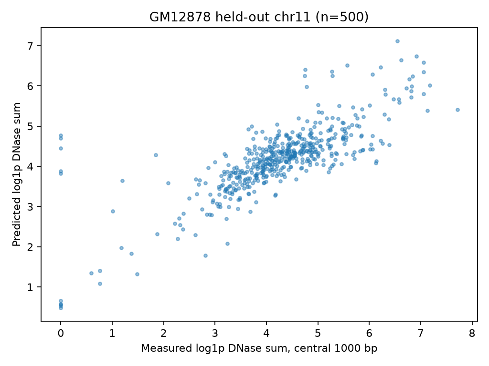
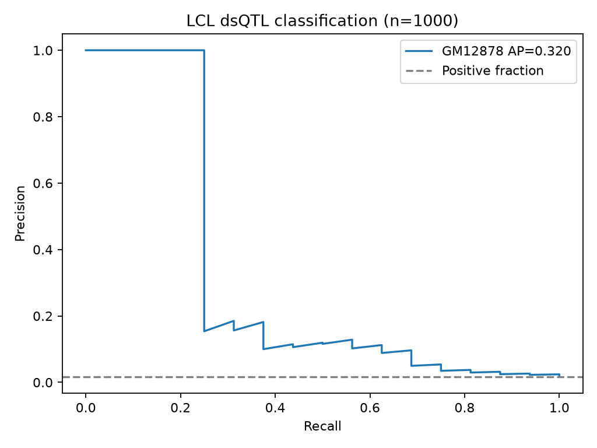

# GM12878 biological benchmark

Fixed samples; DNase is within-experiment held-out chr11 evaluation. dsQTL loci can overlap model training chromosomes. No wet-lab validation of designs or attributions.

Model predictions use the website’s existing ModelAdapter on CPU. No weights were trained or changed.

DNase targets: hg38, chr11, log1p(sum central 1000 bp); missing bigWig bases become zero, matching gReLU.
dsQTL: original hg19 allele1/allele2 convention, reverse-complement averaging, absolute effect ranking.
Variant website CSV uses score/(1+score), a monotonic ranking transform, NOT calibrated probabilities. Ignore its calibration/Brier metrics.

## dnase

| Metric | Value |
|---|---|
| samples | 500 |
| Pearson r | 0.7847196531250741 |
| Spearman rho | 0.7800279904704129 |
| MSE | 0.570838535045015 |
| RMSE | 0.755538572837294 |
| MAE | 0.49746227616071703 |
| shuffled_prediction_MSE | 2.1903880256893995 |
| shuffled_prediction_Pearson | 0.012731445438832327 |

## dsqtl

| Metric | Value |
|---|---|
| samples | 1000 |
| positives | 16 |
| positive_fraction | 0.016 |
| average_precision | 0.31954299519812057 |
| AUROC | 0.8366996951219512 |
| gkmSVM_average_precision_same_sample | 0.26327585277820176 |

## Limits

This is a sampled evaluation, not a full published benchmark reproduction. Nearby DNase windows can overlap; rows are not independent experimental replicates. QTL labels are associations, not proof of causal effects. No dataset here validates sequence design, multi-variant haplotypes, or attribution mechanisms.

Protocol source: https://github.com/Genentech/gReLU-applications/blob/d98346a34e74a88cc7ad47b5596925e8858c211a/VEP_benchmark/
Checkpoint SHA256: `f266b296f49b4e97e3ac52e94594da0aaae1d467778ea58b421e1ee7c4482bea`

## Website execution checks

All five isolated Flask request checks passed: sequence prediction, published
variant comparison, batch variants, regression Benchmark, and binary Benchmark.
Website prediction scores and applicable benchmark metrics matched the standalone
evaluation. These were request-level integration checks, not browser automation.
See [website_checks.json](website_checks.json) and the saved `website_*.html`
pages for evidence. Three scientific-convention unit tests also passed; five
sampled DNase labels agreed with independently computed exact bigWig sums.

The model's biological predictive ability and the website's successful execution
are separate results. Pearson correlation is not percentage accuracy. The dsQTL
estimate is preliminary because this sample contains only 16 positives, and its
loci can overlap training chromosomes. One published variant, rs7338868, was
excluded because neither supplied allele matched hg19 at the supplied position.
